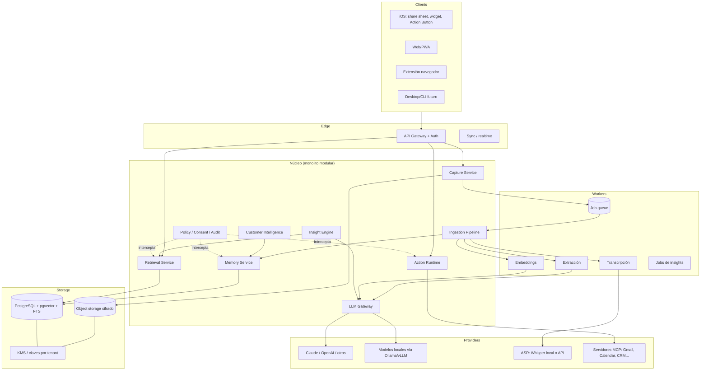

# Entregable 2 — Arquitectura técnica

> Estado: propuesta v0.1. Cada decisión relevante tiene un ADR en `docs/adr/`.
> Principio rector: **monolito modular sobre PostgreSQL**, con costuras claras para extraer servicios cuando duela, no antes.

## 1. Diagrama de componentes



Regla: **toda lectura/escritura de memoria y toda acción pasa por Policy** (permisos + consentimiento + auditoría). No hay camino de datos que la evite.

## 2. Flujo de información (captura → conocimiento → uso)

1. **Captura**: el cliente envía `Source` crudo (audio/texto/archivo/URL) + contexto (hora, dispositivo, ubicación si autorizada). Se guarda inmutable en object storage y se registra en `sources`.
2. **Ingestión (asíncrona)**: transcribir → segmentar → extraer entidades y relaciones candidatas → deduplicar/resolver entidades (¿"Pérez" es la persona X?) → embeddings por aspecto → persistir.
3. **Persistencia con procedencia**: cada hecho/entidad apunta a `source` + fragmento (offset/timestamp) + `origin_kind` (ver §4) + `confidence` + `validation_state`.
4. **Consolidación periódica** (jobs): resúmenes jerárquicos, fusión de duplicados, decaimiento de relevancia, actualización de perfiles.
5. **Uso**: recuperación híbrida → composición de contexto con citas → LLM → respuesta/insight/acción propuesta.
6. **Feedback**: correcciones, 👍/👎, aprobaciones se guardan como eventos y alimentan perfil y ranking (sin reentrenar modelos).

Principio: la ingestión es **idempotente y re-ejecutable** desde la fuente cruda. Si mañana hay un mejor extractor, se reprocesa. Los derivados son descartables; las fuentes no.

## 3. Arquitectura de memoria

### 3.1 Capas

| Capa | Contenido | Almacenamiento |
|---|---|---|
| Fuentes (episódica cruda) | audio, texto original, documentos | object storage + fila en `sources` |
| Fragmentos | chunks de fuente con timestamp/offset | `chunks` (texto, tsvector, embeddings) |
| Semántica estructurada | entidades, relaciones, hechos | tablas relacionales |
| Perfil dinámico | preferencias, estilo, contexto de proyecto | `profile_facts` con fuente y confianza |
| Resúmenes / largo plazo | resúmenes por proyecto/persona/período | `digests`, regenerables |

### 3.2 Recuperación híbrida

`score = fusión(RRF) de [búsqueda vectorial, BM25/FTS, filtro estructural, boost temporal, boost por relaciones del grafo]`

- Vectorial: pgvector (HNSW). Textual: `tsvector` (o `pg_search`/ParadeDB si hace falta BM25 real).
- Filtros duros siempre primero: `workspace_id`, permisos, estado, rango temporal.
- Expansión por grafo: desde los resultados, traer vecinos a 1–2 saltos vía tabla de relaciones (CTE recursivos).
- Re-ranking opcional con modelo barato sólo si la métrica lo justifica.

### 3.3 ¿pgvector alcanza? ¿Vector DB o grafos aparte?

**Recomendación: PostgreSQL + pgvector + FTS + tabla de relaciones. Sin vector DB ni graph DB en MVP.**

- Volumen personal: 10⁵–10⁷ fragmentos → trivial para pgvector HNSW. Incluso enterprise por tenant cabe.
- Ventaja decisiva: **transacciones y RLS con los mismos datos** → el aislamiento por usuario/tenant se resuelve en un solo lugar. Una vector DB aparte duplica el problema de permisos (fuga de datos entre usuarios).
- Grafo: las consultas útiles son 1–3 saltos; CTE recursivo alcanza. Neo4j se justificaría con algoritmos de grafo pesados (comunidades, caminos largos) a gran escala. Reevaluar en Fase 5 con datos reales (ADR-0003).
- Señales para migrar: p95 de búsqueda >300 ms con filtros, >50 M vectores en un tenant, necesidad de algoritmos de grafo. Mitigación: interfaz `RetrievalStore` desacoplada.

### 3.4 ¿Multi-vector?

**Sí, pero acotado.** Un recuerdo se embebe en hasta 3 "vistas": (a) contenido literal, (b) **resumen/idea abstracta** (clave para conectar ideas de dominios distintos), (c) opcional: problema/solución o intención. Se modela como `embeddings(entity_id, aspect, model, vector)`, con `model` versionado para poder re-embeber. Empezar con (a)+(b), medir si (b) mejora las conexiones. No más vistas sin evidencia.

### 3.5 Memoria evolutiva sin entrenar modelos

- Perfil dinámico = hechos con fuente, confianza y **fecha de validez** (reemplazo, no sobrescritura; historial en `*_history`).
- Estilo de escritura: ejemplos recuperados (few-shot) de mails aprobados, no fine-tuning.
- Ranking personalizado: pesos por tipo/feedback.
- Todo editable y borrable por el usuario.

## 4. Modelo de conocimiento y procedencia

Tablas núcleo (simplificadas; DDL real en Fase 1):

```
tenants(id, kind[personal|org], ...)
users(id, ...)                       memberships(user_id, workspace_id, role)
workspaces(id, tenant_id, kind[personal|client|team|org], ...)

sources(id, workspace_id, owner_id, kind, uri, captured_at, context jsonb, sha256, consent_id)
chunks(id, source_id, locator, text, tsv, ...)
embeddings(chunk_or_entity_id, aspect, model, vector)

entities(id, workspace_id, owner_id, type, title, body, 
         origin_kind, confidence, validation_state, created_at, updated_at, valid_from, valid_to)
  -- type: thought|idea|concept|project|person|conversation|meeting|decision|task|event|org|opportunity
entity_history(entity_id, version, diff, changed_by[user|ai|import], at)
relations(id, from_id, to_id, kind, origin_kind, confidence, rationale, evidence[], created_by, validation_state)
provenance(entity_id, source_id, chunk_id, quote, asserted_by_person_id)
```

**Distinciones críticas** (campo `origin_kind` + `validation_state`):

- `origin_kind`: `own_thought` | `said_by_other` | `ai_generated` | `imported` | `derived`
- `epistemic_status`: `observation` | `claim` | `hypothesis` | `decision_confirmed` | `proposal`
- `validation_state`: `unreviewed` | `confirmed` | `corrected` | `rejected`

Reglas: (1) la IA **nunca** escribe como `own_thought` ni `confirmed`; (2) una inferencia siempre apunta a evidencias (`evidence[]`); (3) observaciones e inferencias son filas distintas — nunca se mezclan en un mismo campo; (4) lo corregido por el usuario tiene prioridad y no se pisa en reprocesos.

### 4.1 Customer Intelligence (extensión del modelo)

- `organizations`, `contacts` (personas con rol comercial), `opportunities`, `proposals`, `interactions`.
- `profile_facts(subject_id, category, value, kind[declared|observed|inferred], source, confidence, valid_from, valid_to, visibility)`.
- Categorías permitidas: necesidades, objeciones, preferencias de comunicación *declaradas*, sensibilidad al precio *expresada*, intereses técnicos. **Prohibido** en el esquema: rasgos de personalidad, emociones, salud, etc. (lista de categorías cerradas; ver `docs/06-privacy-legal.md`).
- `price_catalog`, `discount_policies`: fuente única autorizada para importes. El generador de propuestas **solo puede referenciar** IDs del catálogo; el LLM redacta, no calcula ni inventa precios (validación determinística posterior).
- Aprendizaje comercial: tabla `outcomes` (aceptada/rechazada/tiempo de cierre); estadísticas descriptivas con tamaño de muestra visible; no se presentan como causalidad.

## 5. Multi-tenant y espacios de conocimiento (siguiente paso que propusiste)

Detalle en `docs/adr/0004-multi-tenant-y-comparticion.md`. Resumen:

- **Workspace** es la unidad de aislamiento. Cada fila de datos lleva `workspace_id`. Tipos: `personal`, `client`, `team`, `org`.
- **RLS de PostgreSQL** obligatorio: toda sesión fija `app.user_id` y `app.workspace_ids`; sin política, no hay acceso. Pruebas automáticas de aislamiento en CI.
- **Compartir = copiar con referencia, no conceder acceso a la base**. Un `share_grant` (ver abajo) publica un *objeto compartido* (snapshot o vínculo vivo) en un workspace destino; el receptor nunca consulta la memoria privada del emisor.
- `share_grants(id, grantor, grantee_or_workspace, scope[entity|project|query_pattern], entities[], permissions[read|derive|quote], expires_at, revoked_at, purpose, consent_record)`.
- **Nivel 0–6** de tu lista se mapea así: 1 privado = workspace personal sin grants; 2 idea puntual = grant sobre 1 entidad; 3 proyecto = grant sobre subgrafo etiquetado; 4 espacio colaborativo = workspace `team` con membresía; 5 inter-org = grants entre tenants vía broker; 6 colectivo empresarial = workspace `org` con roles y políticas de data governance.
- **Revocación**: elimina el vínculo y los derivados *no consolidados*; lo ya visto/copiado se documenta como límite (no se puede "des-ver"). Se avisa al usuario antes de compartir.
- **Cifrado**: clave de datos por tenant (envelope encryption con KMS); posibilidad futura de claves por usuario (E2EE) con costo en funcionalidad server-side (ver ADR-0006).

### 5.1 Inteligencia colectiva (Fase 5)

No se implementa como "agentes que se leen las memorias". Se implementa como **broker de matching con mínima exposición**:

1. Modelo **push**: cada usuario publica una *proyección* que él mismo aprueba (título + resumen, sin texto original ni embeddings propios) en `discovery_offers`, en un esquema y rol separados (`ms_broker`). El broker **nunca** lee tablas de memoria.
2. El broker calcula sus propios embeddings sobre esas proyecciones, hace matching periódico (sin consultas libres, con límites de tasa y umbral) y propone un *encuentro*: ambas partes ven "hay una posible sinergia entre tu idea A y una idea de alguien", sin identidad hasta que acepten. Detalle en `08-revision-seguridad-aislamiento.md` §4.
3. Si ambos aceptan → se crea un workspace colaborativo; cada aporte conserva autoría. La IA sintetiza en ese espacio únicamente con el material allí aportado.
4. Riesgos tratados: filtración por inferencia (embeddings pueden revelar contenido → exponer sólo resúmenes aprobados por el emisor), atribución de ideas/IP (acuerdo de términos al crear el espacio), spam/abuso, cold start (empezar con grupos cerrados).

## 6. Arquitectura multi-LLM

- **LLM Gateway** propio y fino (interfaz única `complete / stream / embed / transcribe / tool_call`), con adaptadores por proveedor. Evaluar LiteLLM como base vs. implementación propia (D-06); lo que no se negocia es que el dominio **nunca importe un SDK de proveedor**.
- **Enrutamiento por tarea** (tabla de configuración, no código):

| Tarea | Perfil | Ejemplo inicial |
|---|---|---|
| Clasificar captura / extracción simple | rápido y barato | Haiku-class / modelo local pequeño |
| Extracción estructurada de reuniones | medio, JSON estricto | Sonnet-class |
| Análisis de relaciones / ideación | potente | Opus/Fable-class |
| Redacción de mails con estilo | medio + few-shot | Sonnet-class |
| Embeddings | modelo de embeddings versionado | API o local (bge/e5) |
| ASR | Whisper local o API | por decisión de privacidad |

- Salidas **estructuradas validadas** (JSON schema) + reintentos; evals por tarea con un set dorado propio (ADR-0007).
- Política de datos por modelo: etiqueta `data_class` (ej. `client_confidential`) que prohíbe enviar a ciertos proveedores; las organizaciones pueden exigir sólo modelos locales o con zero-retention.
- Cambiar de embeddings implica re-embeber: por eso `model` está en la tabla y se guardan los textos.

### 6.1 ¿Multiagente u orquestador?

**Orquestador único con herramientas** (workflow determinístico donde se pueda + loop de agente con tool-calling donde haya incertidumbre). Los "agentes" del MVP son *pipelines* (ingestión, insights nocturnos). Un agente por usuario existe como concepto de producto, pero técnicamente es el mismo orquestador con el contexto/permiso de ese usuario. Se justifica multiagente real sólo si: hay tareas paralelizables con contexto aislado o fronteras de permiso distintas (colectivo, Fase 5). Ver ADR-0005.

## 7. Integraciones y ejecución de acciones

- **MCP** como contrato de integración con herramientas externas (Gmail, Calendar, CRM, Drive). MindSync actúa como *cliente MCP*; también puede exponer su memoria como *servidor MCP* (permite usar MindSync desde Claude/otros: refuerza el "memoria del usuario, no del proveedor"). Cuidado: MCP no resuelve autorización de negocio; eso lo hace Action Runtime.
- **Action Runtime**: `Intent → Plan → Propuesta (diff/preview) → Aprobación → Ejecución → Auditoría`.
  - Cada herramienta declara: efectos (`read` | `write_reversible` | `write_irreversible`), alcance, datos que toca.
  - Política por defecto: lectura libre dentro del permiso; **escritura/envío siempre con aprobación explícita**; automatización sólo por regla que el usuario habilita (ej. "responder confirmaciones de reunión") y con tope de riesgo.
  - Idempotencia, límites de tasa, `dry_run`, registro inmutable de auditoría.
  - **Defensa contra prompt injection**: el contenido de mails/web/documentos es *dato no confiable*; nunca puede disparar acciones por sí mismo; las acciones sólo se derivan de la instrucción del usuario o de reglas habilitadas. Separación de contexto entre "instrucciones" y "contenido recuperado".
- Resolución de intención ("mandale el billing a Pérez"): recuperación de entidad `person` (desambiguar si hay >1), de interacciones previas y de ejemplos de estilo; si la confianza es baja, **preguntar** en vez de adivinar.

## 8. Captura y clientes

- **Cliente primero: Web/PWA** (el desarrollo más barato, multi-plataforma, cubre Linux/Windows/iPhone parcialmente) + **iOS** para fricción baja.
- iOS: share sheet, App Intents/Shortcuts, widgets y Action Button para dictar una idea; dictado → subida diferida (background upload). Limitación real: iOS no permite escucha ambiental continua en segundo plano de forma fiable ni grabar llamadas; las grabaciones de reuniones presenciales requieren app en primer plano o sesión de audio explícita. Android es menos restrictivo pero el foreground service y el consentimiento visible son obligatorios.
- Extensión de navegador: "enviar selección/página" (Fase 2).
- Reuniones: Fase 1 = subir transcripción/audio; Fase 2 = grabación desde app/escritorio con consentimiento visible; integración con Meet/Zoom/Teams vía APIs/bots oficiales con aviso a participantes.
- Contexto (GPS, actividad): **opt-in por señal**, capturado sólo en el momento de una captura o consulta ("point-in-time"), almacenado con precisión reducida salvo que el usuario elija más. Continuo = futuro.
- Sincronización: servidor como fuente de verdad; cliente con cola offline (outbox) y resolución simple (las fuentes son append-only; las ediciones usan versionado + last-write-wins por campo).

## 9. Seguridad y privacidad (resumen; detalle en `06-privacy-legal.md`)

- AuthN: passkeys/OIDC; sesiones cortas; MFA en enterprise.
- AuthZ: RBAC por workspace + ABAC por `data_class` y `share_grant`; deny por defecto.
- Cifrado en tránsito (TLS) y reposo; envelope encryption por tenant; audio cifrado en object storage con URL firmadas de vida corta.
- Auditoría append-only de lecturas sensibles, grants, acciones, y de **qué fragmentos se enviaron a qué LLM** (trazabilidad de inferencias).
- Derechos: exportación completa, borrado en cascada (incluye derivados, embeddings y backups con ventana definida), retención configurable.
- Terceros en reuniones: registro de consentimiento por reunión; datos de terceros no se usan para perfilado sin base legal; derecho de los participantes a pedir borrado.
- Minimización: no enviar al LLM más contexto del necesario; redacción de PII opcional antes de proveedores externos.

## 10. Decisiones tecnológicas (propuestas, justificadas)

| Área | Propuesta | Justificación | Alternativa |
|---|---|---|---|
| Backend | **TypeScript (Node, NestJS o Fastify) o Python (FastAPI)** — ver D-03 | Ecosistema LLM fuerte en ambos; elegir según tu fortaleza | Go/Rust: prematuro |
| DB | PostgreSQL 16+ con pgvector, RLS, FTS | Una sola fuente de verdad y de permisos | Vector DB/Neo4j: ADR-0003 |
| Colas/jobs | Postgres-based (pg-boss / Procrastinate / Graphile Worker) en MVP | Menos infraestructura | Redis+BullMQ/Celery, luego Temporal |
| Object storage | S3-compatible (S3/R2/MinIO) | Portabilidad, self-host | — |
| Web | React/Next.js + PWA | Rapidez | SvelteKit |
| iOS | Swift/SwiftUI nativo mínimo (share ext., intents) | Sólo nativo da fricción baja | React Native/Expo si priorizás velocidad (D-04) |
| ASR | Whisper (faster-whisper local) o API (Deepgram/AssemblyAI/OpenAI) | Diarización mejor en APIs | — |
| Despliegue | Contenedores; un solo servicio + worker + Postgres | Empezar simple; self-host posible | K8s después |
| Observabilidad | OpenTelemetry + registro de llamadas LLM (coste, latencia, modelo) | Medir calidad y gasto desde el día 1 | — |

## 11. Riesgos arquitectónicos principales

1. **Calidad de la extracción y de las conexiones** (falsos positivos) → evals + feedback + umbrales + explicar siempre.
2. **Fuga entre usuarios/tenants** → RLS + tests de aislamiento + revisión de seguridad antes de Fase 5.
3. **Costo de LLM/ASR** → enrutamiento por tarea, batch nocturno, caché, modelos locales.
4. **Prompt injection vía contenido capturado** → separación datos/instrucciones + aprobaciones.
5. **Complejidad prematura** → cada componente nuevo requiere ADR con "qué dolor real resuelve".
